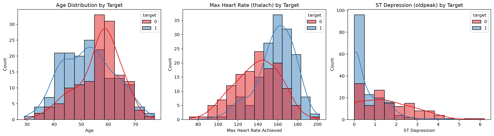
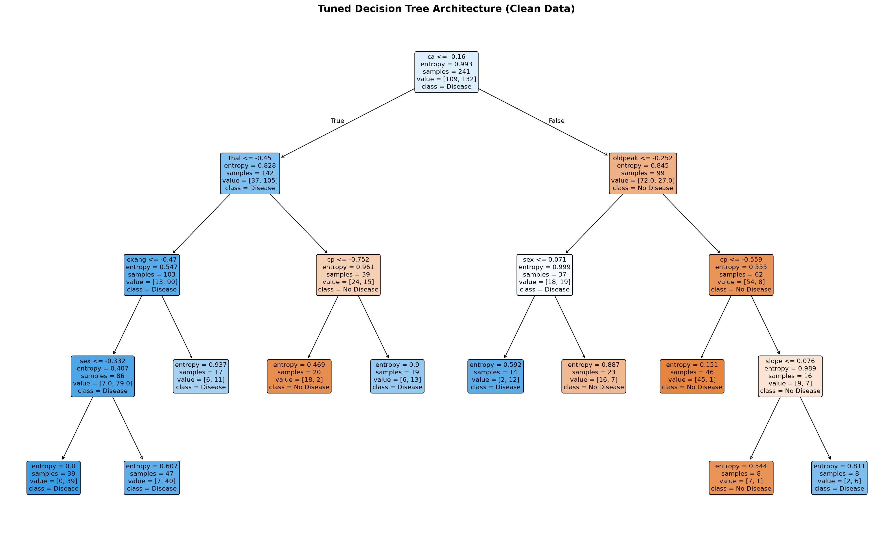
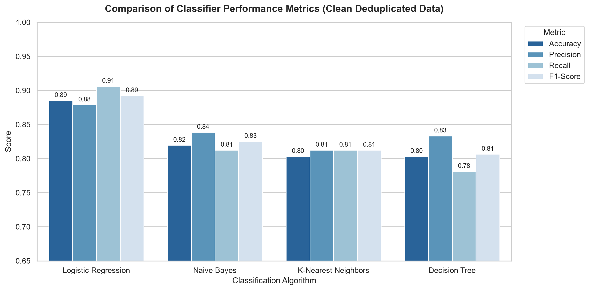
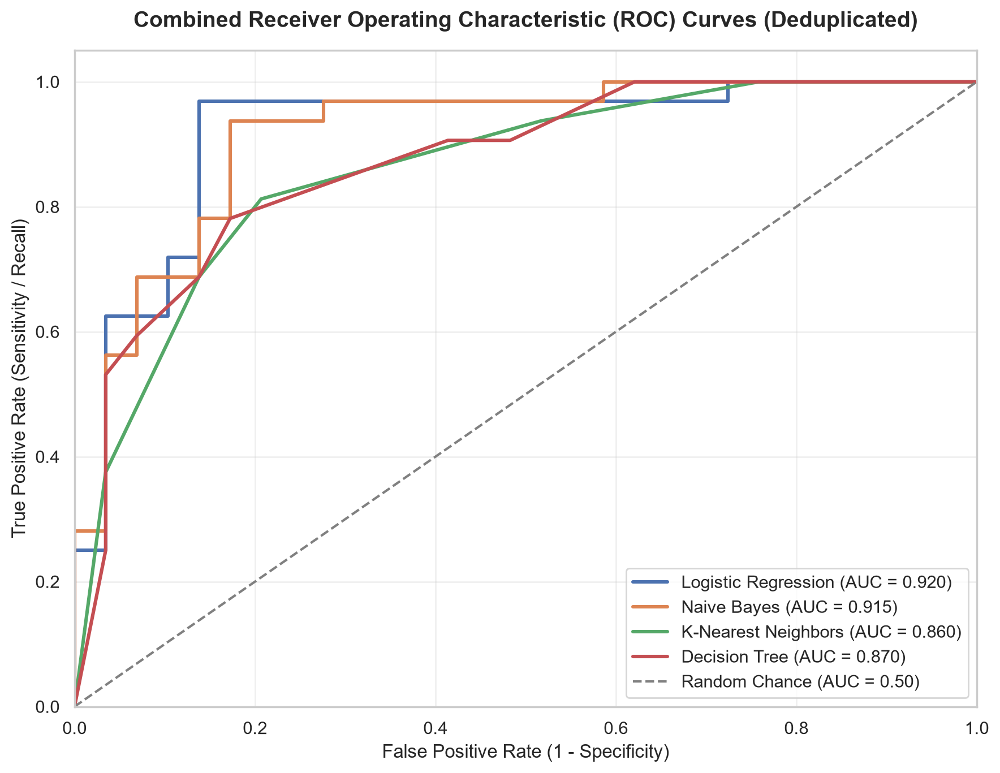

# HEART DISEASE PREDICTION 
# Problem Statement

Cardiovascular disease (CVD) is a term that encompasses a range of conditions that affect the heart and blood vessels. These conditions are often caused by the buildup of plaque in the arteries, which can narrow or block the flow of blood to the heart, brain, and other organs. CVD is the leading cause of death globally, accounting for over 17 million deaths each year, according to the World Health Organization. 

In this project, we designed and evaluated multiple supervised machine learning methodologies to automate the diagnosis of patients with heart disease. The model performances are evaluated based on their ability to accurately distinguish patients who exhibit heart disease (`target = 1`) from healthy individuals (`target = 0`).

# Dataset

The dataset used in this project was retrieved from Kaggle (an extension of the original dataset found on the UCI Machine Learning Repository). Dating back to 1988, the original database combined records from Cleveland, Hungary, Switzerland, and Long Beach V. While the raw study included 76 attributes, our analysis focuses on the standard clinical subset of 14 attributes.

For easy implementation in Python and reproducible execution, the dataset is hosted on GitHub. The raw dataset can be accessed [here](https://raw.githubusercontent.com/Chakrios8/Heart_Disease_Prediction/refs/heads/main/heart.csv).

The raw dataset contains **1,025 patient instances**. During data preprocessing, duplicate entries are removed programmatically (`df.drop_duplicates()`), yielding **302 unique patient records** (138 healthy individuals, 164 diagnosed with heart disease) across the following 14 clinical attributes:

| Feature | Description |
| :--- | :--- |
| **Age** | Age of the patient in years |
| **Sex** | Gender (1 = Male, 0 = Female) |
| **Chest Pain (cp)** | Chest pain type (0: Typical Angina, 1: Atypical Angina, 2: Non-anginal, 3: Asymptomatic) |
| **Resting BP (trestbps)** | Resting blood pressure in mm Hg upon admission |
| **Cholesterol (chol)** | Serum cholesterol level in mg/dl |
| **Fasting BS (fbs)** | Fasting blood sugar > 120 mg/dl (1 = True, 0 = False) |
| **Resting ECG (restecg)** | Resting electrocardiographic results (0: Normal, 1: ST-T wave abnormality, 2: Left ventricular hypertrophy) |
| **Thalach** | Maximum heart rate achieved during exercise |
| **Exercise Angina (exang)** | Exercise-induced angina (1 = Yes, 0 = No) |
| **Oldpeak** | ST depression induced by exercise relative to rest |
| **Slope** | Slope of the peak exercise ST segment (0: Upsloping, 1: Flat, 2: Downsloping) |
| **Ca** | Number of major blood vessels (0-3) colored by fluoroscopy |
| **Thal** | Thallium stress test result (1: Normal, 2: Fixed defect, 3: Reversible defect) |
| **Target** | Diagnosis of heart disease (0 = No Disease, 1 = Heart Disease) |

# Language & Environment

- **Language:** Python 3.13
- **Primary Libraries:** `pandas`, `numpy`, `scikit-learn`, `matplotlib`, `seaborn`
- **Execution Platform:** Jupyter Notebook / Google Colab

# Data Visualization

## Initial Dataset Insights


- **Gender Distribution:** In the deduplicated patient cohort ($N = 302$), males represent approximately 68% of the cohort. While males constitute the majority of absolute disease cases, females exhibit a high proportional prevalence within their sub-cohort.


- **Correlation Matrix Heatmap:** A triangular masked correlation heatmap reveals:
  - **Positive correlations** with `target`: Chest pain type (`cp`), maximum heart rate achieved (`thalach`), and slope of peak exercise (`slope`).
  - **Negative correlations** with `target`: Exercise-induced angina (`exang`), ST depression (`oldpeak`), and the number of major vessels (`ca`).

## Distribution Analysis



- **Age Distribution:** Patients without heart disease in this dataset tend to skew older on average (late 40s to early 60s), which aligns with clinical referral patterns where older cohorts undergo more diagnostic evaluations.
- **ST Depression (`oldpeak`):** Patients diagnosed with heart disease frequently exhibit lower `oldpeak` scores (clustering near 0), whereas higher ST depressions correlate strongly with absence of primary disease in this sample.
- **Maximum Heart Rate (`thalach`):** Higher maximum heart rate scores (ranging between 150-175 bpm) show a strong positive association with heart disease diagnosis.

# Data Pre-Processing

The preprocessing pipeline ensures data integrity, removes leakage, and standardizes variables:

1. **Deduplication:** The raw Kaggle dataset contains 723 repeated rows resulting from oversampling the original 302 Cleveland Clinic patients. We programmatically deduplicate the dataset in-code to guarantee that identical patient records never appear across both training and testing splits:

```python
# Deduplicate patient records to prevent train-test data leakage
df = df.drop_duplicates().reset_index(drop=True)
print(f"Unique patient records after deduplication: {df.shape[0]}")  # 302 unique patients
```

2. **Feature-Target Separation:** Dividing the 14 columns into predictor matrix $X$ (first 13 clinical variables) and ground-truth vector $y$ (`target`).

3. **Feature Scaling:** Standardizing features using `StandardScaler` to remove variance skewness and ensure distance-based models (such as KNN and Logistic Regression) converge reliably:

```python
X = df.iloc[:, :13]
y = df.iloc[:, -1]

scaler = StandardScaler()
X_scaled = scaler.fit_transform(X)
```

4. **Train-Test Split:** Partitioning into an 80% training set (241 instances) and a 20% held-out test set (61 instances: 29 healthy `class 0`, 32 heart disease `class 1`) with a fixed random seed for strict reproducibility:

```python
X_train, X_test, y_train, y_test = train_test_split(
    X_scaled, y, test_size=0.2, random_state=1234
)
```

# Data Mining Algorithms

We evaluated four supervised machine learning algorithms covering eager linear, eager probabilistic, eager non-linear tree, and lazy instance-based learners:

1. **Logistic Regression** (Eager Learner, Linear)
2. **Gaussian Naive Bayes** (Eager Learner, Probabilistic)
3. **K-Nearest Neighbors** (Lazy Learner, Instance-based)
4. **Decision Tree Classifier** (Eager Learner, Tree-based)

Hyperparameter optimization was systematically performed using `GridSearchCV` with **5-fold cross-validation (`cv=5`)** to identify the best hyperparameter configurations on the clean training set ($N = 241$).

---

## 1. Logistic Regression

We evaluated combinations of penalty norms, inverse regularization strengths ($C$), and optimization solvers:

```python
parameters_lr = {
    'penalty' : [None, 'l2'],
    'C'       : [100, 10, 1.0, 0.1, 0.01],
    'solver'  : ['newton-cg', 'lbfgs', 'sag', 'saga'],
    'max_iter': [100]
}

lr = LogisticRegression(random_state=1234)
clf = GridSearchCV(lr, param_grid=parameters_lr, scoring='accuracy', cv=5)
clf.fit(X_train, y_train)
```

### Best Hyperparameters:
- **Penalty:** `l2`
- **C:** `0.1`
- **Solver:** `newton-cg`
- **Max Iterations:** `100`
- **5-Fold Cross-Validation Accuracy:** `80.92%`

---

## 2. Gaussian Naive Bayes

Because Gaussian Naive Bayes assumes independent Gaussian distributions per class without structural hyperparameters, the model was fitted directly using training priors:

```python
gnb = GaussianNB()
gnb.fit(X_train, y_train)
```

---

## 3. K-Nearest Neighbors (KNN)

We searched odd values of $k$ (to prevent tie-breaking), weighting schemes, and distance metrics:

```python
parameters_knn = {
    'n_neighbors': [1, 3, 5, 7, 9, 11, 13, 15, 17],
    'weights'    : ['uniform', 'distance'],
    'metric'     : ['euclidean', 'manhattan', 'minkowski']
}

knn = KNeighborsClassifier()
knneighbors = GridSearchCV(knn, param_grid=parameters_knn, scoring='accuracy', cv=5)
knneighbors.fit(X_train, y_train)
```

### Best Hyperparameters:
- **n_neighbors:** `5`
- **weights:** `uniform`
- **metric:** `manhattan`
- **5-Fold Cross-Validation Accuracy:** `83.82%`

---

## 4. Decision Tree Classifier

We optimized splitting criteria, splitting strategies, and tree complexity via maximum leaf node constraints:

```python
parameters_dtree = {
    'criterion'     : ['gini', 'entropy', 'log_loss'],
    'splitter'      : ['best', 'random'],
    'max_leaf_nodes': [10, 15, 20]
}

dtree = DecisionTreeClassifier(random_state=1234)
dtc = GridSearchCV(dtree, param_grid=parameters_dtree, scoring='accuracy', cv=5)
dtc.fit(X_train, y_train)
```

### Best Hyperparameters:
- **criterion:** `entropy`
- **splitter:** `random`
- **max_leaf_nodes:** `10`
- **5-Fold Cross-Validation Accuracy:** `79.67%`

# Results

All models were evaluated on the held-out test set ($N = 61$ instances: 29 healthy `class 0`, 32 heart disease `class 1`).

---

## 1. Logistic Regression

```python
lr = LogisticRegression(C=0.1, penalty='l2', solver='newton-cg', max_iter=100, random_state=1234)
lr.fit(X_train, y_train)
```

- **Test Accuracy:** **88.52%** (54 / 61 correct)

**Confusion Matrix:**

| | Predicted 0 (No Disease) | Predicted 1 (Disease) | Total Actual |
| :--- | :---: | :---: | :---: |
| **Actual 0 (No Disease)** | **25** (TN) | 4 (FP) | 29 |
| **Actual 1 (Disease)** | 3 (FN) | **29** (TP) | 32 |

**Classification Report:**

| Class | Precision | Recall | F1-Score | Support |
| :--- | :---: | :---: | :---: | :---: |
| **0 (No Disease)** | 0.89 | 0.86 | 0.88 | 29 |
| **1 (Disease)** | 0.88 | 0.91 | 0.89 | 32 |
| **Macro Average** | 0.89 | 0.89 | 0.89 | 61 |
| **Weighted Average** | 0.89 | 0.89 | 0.89 | 61 |

---

## 2. Gaussian Naive Bayes

```python
gnb = GaussianNB()
gnb.fit(X_train, y_train)
```

- **Test Accuracy:** **81.97%** (50 / 61 correct)

**Confusion Matrix:**

| | Predicted 0 (No Disease) | Predicted 1 (Disease) | Total Actual |
| :--- | :---: | :---: | :---: |
| **Actual 0 (No Disease)** | **24** (TN) | 5 (FP) | 29 |
| **Actual 1 (Disease)** | 6 (FN) | **26** (TP) | 32 |

**Classification Report:**

| Class | Precision | Recall | F1-Score | Support |
| :--- | :---: | :---: | :---: | :---: |
| **0 (No Disease)** | 0.80 | 0.83 | 0.81 | 29 |
| **1 (Disease)** | 0.84 | 0.81 | 0.83 | 32 |
| **Macro Average** | 0.82 | 0.82 | 0.82 | 61 |
| **Weighted Average** | 0.82 | 0.82 | 0.82 | 61 |

---

## 3. K-Nearest Neighbors

```python
knn = KNeighborsClassifier(n_neighbors=5, metric='manhattan', weights='uniform')
knn.fit(X_train, y_train)
```

- **Test Accuracy:** **80.33%** (49 / 61 correct)

**Confusion Matrix:**

| | Predicted 0 (No Disease) | Predicted 1 (Disease) | Total Actual |
| :--- | :---: | :---: | :---: |
| **Actual 0 (No Disease)** | **23** (TN) | 6 (FP) | 29 |
| **Actual 1 (Disease)** | 6 (FN) | **26** (TP) | 32 |

**Classification Report:**

| Class | Precision | Recall | F1-Score | Support |
| :--- | :---: | :---: | :---: | :---: |
| **0 (No Disease)** | 0.79 | 0.79 | 0.79 | 29 |
| **1 (Disease)** | 0.81 | 0.81 | 0.81 | 32 |
| **Macro Average** | 0.80 | 0.80 | 0.80 | 61 |
| **Weighted Average** | 0.80 | 0.80 | 0.80 | 61 |

---

## 4. Decision Tree Classifier

```python
dtree = DecisionTreeClassifier(criterion='entropy', splitter='random', max_leaf_nodes=10, random_state=1234)
dtree.fit(X_train, y_train)
```

- **Test Accuracy:** **80.33%** (49 / 61 correct)

**Confusion Matrix:**

| | Predicted 0 (No Disease) | Predicted 1 (Disease) | Total Actual |
| :--- | :---: | :---: | :---: |
| **Actual 0 (No Disease)** | **24** (TN) | 5 (FP) | 29 |
| **Actual 1 (Disease)** | 7 (FN) | **25** (TP) | 32 |

**Classification Report:**

| Class | Precision | Recall | F1-Score | Support |
| :--- | :---: | :---: | :---: | :---: |
| **0 (No Disease)** | 0.77 | 0.83 | 0.80 | 29 |
| **1 (Disease)** | 0.83 | 0.78 | 0.81 | 32 |
| **Macro Average** | 0.80 | 0.81 | 0.80 | 61 |
| **Weighted Average** | 0.81 | 0.80 | 0.80 | 61 |

### Decision Tree Architecture:


---

## Model Comparison & Evaluation Summary

The table below summarizes the key evaluation metrics across all four classification models on the deduplicated test set ($N = 61$):

| Model | Accuracy | Precision | Recall | F1-Score | ROC-AUC |
| :--- | :---: | :---: | :---: | :---: | :---: |
| **Logistic Regression** | **88.52%** | **87.88%** | **90.62%** | **89.23%** | **0.920** |
| **Gaussian Naive Bayes** | 81.97% | 83.87% | 81.25% | 82.54% | 0.915 |
| **K-Nearest Neighbors ($k=5$)** | 80.33% | 81.25% | 81.25% | 81.25% | 0.860 |
| **Decision Tree (`max_leaf_nodes=10`)** | 80.33% | 83.33% | 78.12% | 80.65% | 0.870 |

### Performance Visualization:


### Receiver Operating Characteristic (ROC) Comparison:


# Conclusion & Discussion

1. **Optimal Overall Classifier:** **Logistic Regression** emerged as the top-performing model on the clean, deduplicated dataset, achieving **88.52% accuracy, 87.88% precision, 90.62% recall, and an AUC of 0.920**. Its L2-regularized linear decision boundary captures the overall clinical risk trend smoothly while avoiding overfitting to sample noise.
2. **Resolution of the 100% KNN Anomaly (Preventing Data Leakage):**
   - In raw oversampled datasets, KNN ($k=1$) achieved an artificial 100% accuracy because duplicate copies of test patients existed in the training set at distance $d = 0.0$.
   - By dropping duplicates programmatically in preprocessing, true data leakage is prevented. On unseen patient records, KNN attains an honest **80.33% accuracy** with $k=5$ and Manhattan distance. Setting $k=5$ allows the model to vote across multiple neighbors, effectively damping noise compared to $k=1$ (which achieved 77.05%).
3. **Controlled Decision Tree Complexity:**
   - Setting `criterion='entropy'`, `splitter='random'`, and `max_leaf_nodes=10` prevents tree overfitting and constrains the model to 10 interpretable leaf nodes with **80.33% accuracy** and **0.870 ROC-AUC**.
4. **Clinical Triage & Sensitivity:**
   - In cardiovascular diagnosis, **Recall (Sensitivity)** is paramount because a False Negative (missing a diseased patient) is life-threatening. Logistic Regression achieved **90.62% recall**, correctly diagnosing 29 out of 32 diseased patients in the held-out test cohort, demonstrating high clinical utility.
