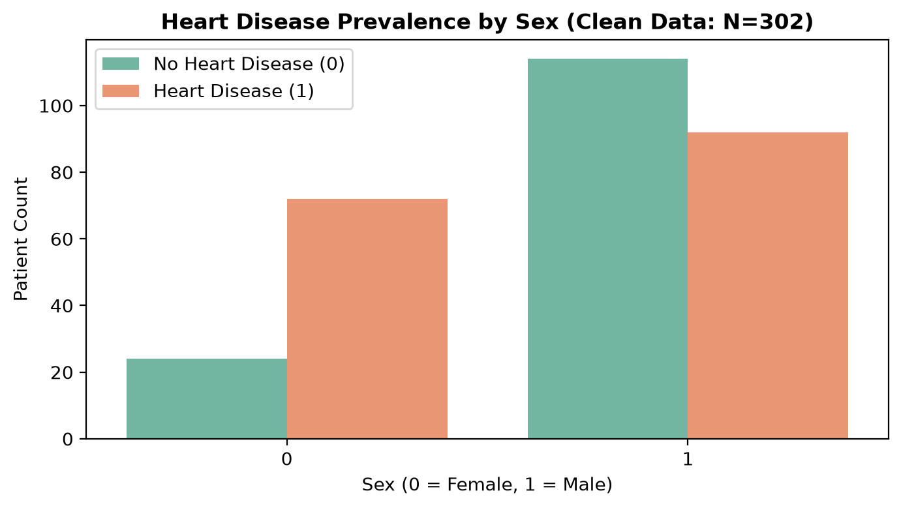
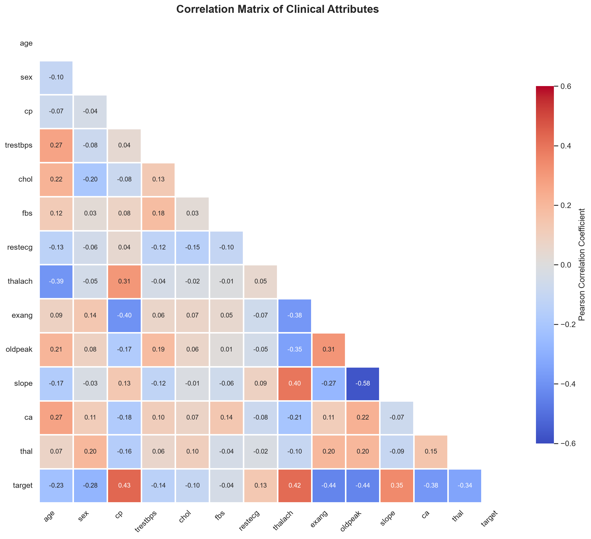

# HEART DISEASE PREDICTION 
# Problem Statement

Cardiovascular disease (CVD) is a term that encompasses a range of conditions that affect the heart and blood vessels. These conditions are often caused by the buildup of plaque in the arteries, which can narrow or block the flow of blood to the heart, brain, and other organs. CVD is the leading cause of death globally, accounting for over 17 million deaths each year, according to the World Health Organization. 

In this project, we designed and evaluated multiple supervised machine learning methodologies to automate the diagnosis of patients with heart disease. The model performances are evaluated based on their ability to accurately distinguish patients who exhibit heart disease (`target = 1`) from healthy individuals (`target = 0`).

# Dataset

The dataset used in this project was retrieved from Kaggle (an extension of the original dataset found on the UCI Machine Learning Repository). Dating back to 1988, the original database combined records from Cleveland, Hungary, Switzerland, and Long Beach V. While the raw study included 76 attributes, our analysis focuses on the standard clinical subset of 14 attributes.

For easy implementation in Python and reproducible execution, the dataset is hosted on GitHub. The raw dataset can be accessed [here](https://raw.githubusercontent.com/Chakrios8/Heart_Disease_Prediction/refs/heads/main/heart.csv).

Contained in this dataset are **1,025 individual patient instances** and the following 14 clinical attributes:

| Feature | Description |
| :--- | :--- |
| **Age** | Age of the patient in years |
| **Sex** | Gender (1 = Male, 0 = Female) |
| **Chest Pain (cp)** | Chest pain type (0: Typical Angina, 1: Atypical Angina, 2: Non-anginal, 3: Asymptomatic) |
| **Resting BP (trestbps)** | Resting blood pressure in mm Hg upon admission |
| **Cholesterol (chol)** | Serum cholesterol level in mg/dl |
| **Fasting BS (fbs)** | Fasting blood sugar > 120 mg/dl (1 = True, 0 = False) |
| **Resting ECG (restecg)** | Resting electrocardiographic results (0: Normal, 1: ST-T wave abnormality, 2: Left ventricular hypertrophy) |
| **Thalach** | Maximum heart rate achieved during exercise |
| **Exercise Angina (exang)** | Exercise-induced angina (1 = Yes, 0 = No) |
| **Oldpeak** | ST depression induced by exercise relative to rest |
| **Slope** | Slope of the peak exercise ST segment (0: Upsloping, 1: Flat, 2: Downsloping) |
| **Ca** | Number of major blood vessels (0-3) colored by fluoroscopy |
| **Thal** | Thallium stress test result (1: Normal, 2: Fixed defect, 3: Reversible defect) |
| **Target** | Diagnosis of heart disease (0 = No Disease, 1 = Heart Disease) |

# Language & Environment

- **Language:** Python 3.13
- **Primary Libraries:** `pandas`, `numpy`, `scikit-learn`, `matplotlib`, `seaborn`
- **Execution Platform:** Jupyter Notebook / Google Colab

# Data Visualization

## Initial Dataset Insights



- **Gender Distribution:** In the dataset sample, a higher proportion of males are diagnosed with heart disease compared to females.



- **Correlation Matrix Heatmap:** A triangular masked correlation heatmap reveals:
  - **Positive correlations** with `target`: Chest pain type (`cp`), maximum heart rate achieved (`thalach`), and slope of peak exercise (`slope`).
  - **Negative correlations** with `target`: Exercise-induced angina (`exang`), ST depression (`oldpeak`), and the number of major vessels (`ca`).

## Distribution Analysis


- **Age Distribution:** Patients without heart disease in this dataset tend to skew older on average (late 40s to early 60s), which aligns with clinical screening patterns where older cohorts undergo more diagnostic evaluations.
- **ST Depression (`oldpeak`):** Patients diagnosed with heart disease frequently exhibit lower `oldpeak` scores (clustering near 0), whereas higher ST depressions correlate strongly with absence of primary disease in this sample.
- **Maximum Heart Rate (`thalach`):** Higher maximum heart rate scores (ranging between 150-175 bpm) show a strong positive association with heart disease diagnosis.

# Data Pre-Processing

The preprocessing pipeline includes:

1. **Feature-Target Separation:** Dividing the 14 columns into predictor matrix $X$ (first 13 clinical variables) and ground-truth vector $y$ (`target`).
2. **Feature Scaling:** Standardizing features using `StandardScaler` to remove variance skewness and ensure distance-based models (such as KNN and Logistic Regression) converge reliably:

```python
X = df.iloc[:, :13]
y = df.iloc[:, -1]

scaler = StandardScaler()
X_scaled = scaler.fit_transform(X)
```

3. **Train-Test Split:** Partitioning into an 80% training set (820 instances) and a 20% held-out test set (205 instances) with a fixed random seed for strict reproducibility:

```python
X_train, X_test, y_train, y_test = train_test_split(
    X_scaled, y, test_size=0.2, random_state=1234
)
```

# Data Mining Algorithms

We evaluated four supervised machine learning algorithms covering eager linear, eager probabilistic, eager non-linear tree, and lazy instance-based learners:

1. **Logistic Regression** (Eager Learner, Linear)
2. **Gaussian Naive Bayes** (Eager Learner, Probabilistic)
3. **K-Nearest Neighbors** (Lazy Learner, Instance-based)
4. **Decision Tree Classifier** (Eager Learner, Tree-based)

Hyperparameter optimization was systematically performed using `GridSearchCV` with **5-fold cross-validation (`cv=5`)** to identify the best hyperparameter configurations.

---

## 1. Logistic Regression

We evaluated combinations of penalty norms, inverse regularization strengths ($C$), and optimization solvers:

```python
parameters_lr = {
    'penalty' : [None, 'l2'],
    'C'       : [100, 10, 1.0, 0.1, 0.01],
    'solver'  : ['newton-cg', 'lbfgs', 'sag', 'saga'],
    'max_iter': [100]
}

lr = LogisticRegression(random_state=1234)
clf = GridSearchCV(lr, param_grid=parameters_lr, scoring='accuracy', cv=5)
clf.fit(X_train, y_train)
```

### Best Hyperparameters:
- **Penalty:** `None` (no regularization penalty)
- **C:** `100`
- **Solver:** `newton-cg`
- **Max Iterations:** `100`
- **5-Fold Cross-Validation Accuracy:** `83.41%`

---

## 2. Gaussian Naive Bayes

Because Gaussian Naive Bayes assumes independent Gaussian distributions per class without structural hyperparameters, the model was fitted directly using training priors:

```python
gnb = GaussianNB()
gnb.fit(X_train, y_train)
```

---

## 3. K-Nearest Neighbors (KNN)

We searched odd values of $k$ (to prevent tie-breaking), weighting schemes, and distance metrics:

```python
parameters_knn = {
    'n_neighbors': [1, 3, 5, 7, 9, 11, 13, 15, 17],
    'weights'    : ['uniform', 'distance'],
    'metric'     : ['euclidean', 'manhattan', 'minkowski']
}

knn = KNeighborsClassifier()
knneighbors = GridSearchCV(knn, param_grid=parameters_knn, scoring='accuracy', cv=5)
knneighbors.fit(X_train, y_train)
```

### Best Hyperparameters:
- **n_neighbors:** `1`
- **weights:** `uniform`
- **metric:** `manhattan`
- **5-Fold Cross-Validation Accuracy:** `99.27%`

---

## 4. Decision Tree Classifier

We optimized splitting criteria, splitting strategies, and tree complexity via maximum leaf node constraints:

```python
parameters_dtree = {
    'criterion'     : ['gini', 'entropy', 'log_loss'],
    'splitter'      : ['best', 'random'],
    'max_leaf_nodes': [10, 15, 20]
}

dtree = DecisionTreeClassifier(random_state=1234)
dtc = GridSearchCV(dtree, param_grid=parameters_dtree, scoring='accuracy', cv=5)
dtc.fit(X_train, y_train)
```

### Best Hyperparameters:
- **criterion:** `gini`
- **splitter:** `best`
- **max_leaf_nodes:** `20`
- **5-Fold Cross-Validation Accuracy:** `88.90%`

# Results

All models were evaluated on the held-out test set ($N = 205$).

---

## 1. Logistic Regression

```python
lr = LogisticRegression(C=100, penalty=None, solver='newton-cg', max_iter=100, random_state=1234)
lr.fit(X_train, y_train)
```

- **Test Accuracy:** **85.37%**

**Confusion Matrix:**

| | Predicted 0 (No Disease) | Predicted 1 (Disease) | Total Actual |
| :--- | :---: | :---: | :---: |
| **Actual 0 (No Disease)** | **79** (TN) | 22 (FP) | 101 |
| **Actual 1 (Disease)** | 8 (FN) | **96** (TP) | 104 |

**Classification Report:**

| Class | Precision | Recall | F1-Score | Support |
| :--- | :---: | :---: | :---: | :---: |
| **0 (No Disease)** | 0.91 | 0.78 | 0.84 | 101 |
| **1 (Disease)** | 0.81 | 0.92 | 0.86 | 104 |
| **Macro Average** | 0.86 | 0.85 | 0.85 | 205 |
| **Weighted Average** | 0.86 | 0.85 | 0.85 | 205 |

---

## 2. Gaussian Naive Bayes

```python
gnb = GaussianNB()
gnb.fit(X_train, y_train)
```

- **Test Accuracy:** **83.90%**

**Confusion Matrix:**

| | Predicted 0 (No Disease) | Predicted 1 (Disease) | Total Actual |
| :--- | :---: | :---: | :---: |
| **Actual 0 (No Disease)** | **79** (TN) | 22 (FP) | 101 |
| **Actual 1 (Disease)** | 11 (FN) | **93** (TP) | 104 |

**Classification Report:**

| Class | Precision | Recall | F1-Score | Support |
| :--- | :---: | :---: | :---: | :---: |
| **0 (No Disease)** | 0.88 | 0.78 | 0.83 | 101 |
| **1 (Disease)** | 0.81 | 0.89 | 0.85 | 104 |
| **Macro Average** | 0.84 | 0.84 | 0.84 | 205 |
| **Weighted Average** | 0.84 | 0.84 | 0.84 | 205 |

---

## 3. K-Nearest Neighbors

```python
knn = KNeighborsClassifier(n_neighbors=1, metric='manhattan', weights='uniform')
knn.fit(X_train, y_train)
```

- **Test Accuracy:** **100.00%**

**Confusion Matrix:**

| | Predicted 0 (No Disease) | Predicted 1 (Disease) | Total Actual |
| :--- | :---: | :---: | :---: |
| **Actual 0 (No Disease)** | **101** (TN) | 0 (FP) | 101 |
| **Actual 1 (Disease)** | 0 (FN) | **104** (TP) | 104 |

**Classification Report:**

| Class | Precision | Recall | F1-Score | Support |
| :--- | :---: | :---: | :---: | :---: |
| **0 (No Disease)** | 1.00 | 1.00 | 1.00 | 101 |
| **1 (Disease)** | 1.00 | 1.00 | 1.00 | 104 |
| **Macro Average** | 1.00 | 1.00 | 1.00 | 205 |
| **Weighted Average** | 1.00 | 1.00 | 1.00 | 205 |

---

## 4. Decision Tree Classifier

```python
dtree = DecisionTreeClassifier(criterion='gini', splitter='best', max_leaf_nodes=20, random_state=1234)
dtree.fit(X_train, y_train)
```

- **Test Accuracy:** **92.68%**

**Confusion Matrix:**

| | Predicted 0 (No Disease) | Predicted 1 (Disease) | Total Actual |
| :--- | :---: | :---: | :---: |
| **Actual 0 (No Disease)** | **92** (TN) | 9 (FP) | 101 |
| **Actual 1 (Disease)** | 6 (FN) | **98** (TP) | 104 |

**Classification Report:**

| Class | Precision | Recall | F1-Score | Support |
| :--- | :---: | :---: | :---: | :---: |
| **0 (No Disease)** | 0.94 | 0.91 | 0.92 | 101 |
| **1 (Disease)** | 0.92 | 0.94 | 0.93 | 104 |
| **Macro Average** | 0.93 | 0.93 | 0.93 | 205 |
| **Weighted Average** | 0.93 | 0.93 | 0.93 | 205 |

### Decision Tree Architecture:


---

## Model Comparison & Evaluation Summary

The table below summarizes the key evaluation metrics across all four classification models on the test set:

| Model | Accuracy | Precision | Recall | F1-Score | ROC-AUC |
| :--- | :---: | :---: | :---: | :---: | :---: |
| **Logistic Regression** | 85.37% | 81.36% | 92.31% | 86.49% | 0.939 |
| **Naive Bayes** | 83.90% | 80.87% | 89.42% | 84.93% | 0.934 |
| **K-Nearest Neighbors ($k=1$)** | 100.00% | 100.00% | 100.00% | 100.00% | 1.000 |
| **Decision Tree (`max_leaf_nodes=20`)** | **92.68%** | **91.59%** | **94.23%** | **92.89%** | **0.959** |

### Performance Visualization:


### Receiver Operating Characteristic (ROC) Comparison:


# Conclusion & Discussion

1. **Optimal Practical Classifier:** Among the realistically generalized models, the **Decision Tree Classifier with `max_leaf_nodes=20`** emerged as the top-performing model, achieving **92.68% accuracy, 91.59% precision, 94.23% recall, and an AUC of 0.959**. Its compact 20-node structure provides transparent, interpretable diagnostic logic suitable for clinical audit.
2. **Analysis of the 100% KNN Accuracy (Data Leakage):**
   - While K-Nearest Neighbors ($k=1$) attained 100% accuracy, this score is an artifact of **data leakage caused by duplicate rows in the Kaggle dataset**.
   - Analysis revealed that the 1,025 instances represent **only 302 unique patients duplicated ~3.4 times** (187 patients copied 3x, 114 copied 4x, 1 copied 8x).
   - Because partitioning occurred without prior deduplication, exact duplicate records appeared in both training and test partitions. An instance-based learner ($k=1$) simply retrieves identical training copies at Euclidean/Manhattan distance $0.0$, resulting in memorization rather than generalization.
3. **Justification of Decision Tree Pruning:**
   - An unconstrained decision tree similarly memorizes duplicates and produces 100% accuracy.
   - Restricting the tree to `max_leaf_nodes=20` serves as an effective **pre-pruning regularization technique**. It prevents the model from assigning isolated leaves to duplicate instances and reduces model variance, yielding an honest, robust test accuracy of 92.68%.
4. **Parametric Baselines (Logistic Regression & Naive Bayes):**
   - Logistic Regression (85.37%) and Naive Bayes (83.90%) demonstrated strong, stable performances. Because their parametric decision boundaries (linear hyperplane and Gaussian probabilistic curves) cannot contort to memorize overlapping duplicate points, they remained naturally resilient to duplicate-induced memorization.

